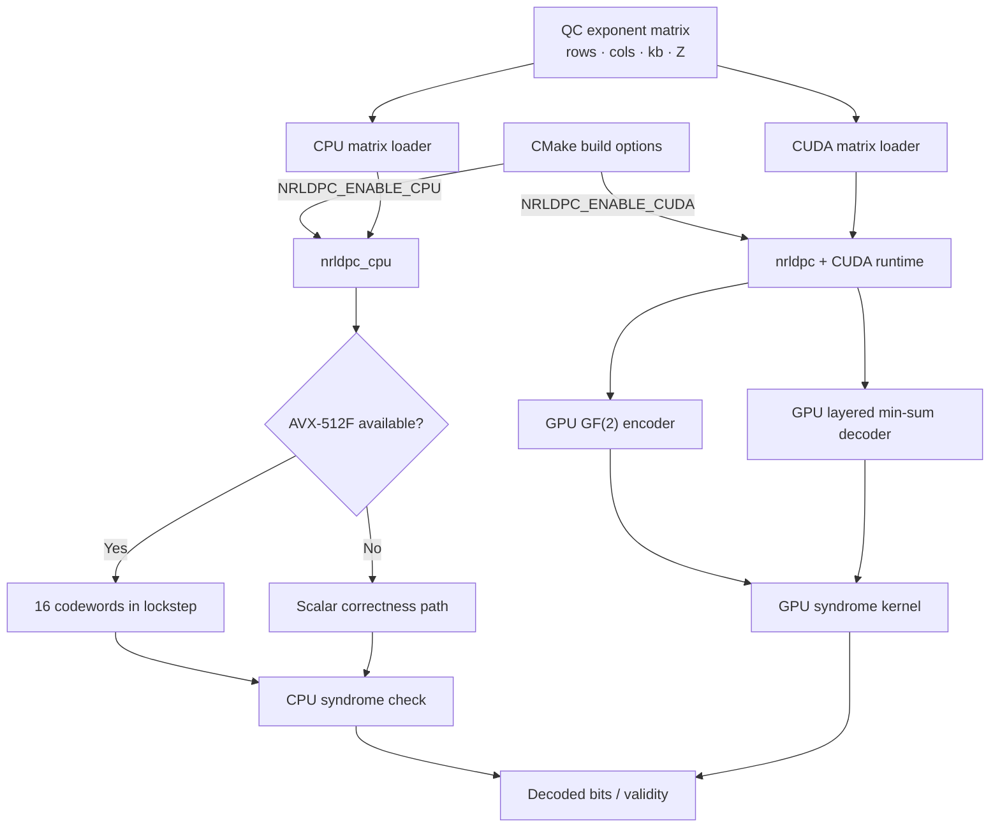

# x86 AVX-512 + CUDA QC-LDPC proof of concept

Reference benchmark project: https://github.com/rcbarke/six-times-to-spare

**STATUS: source prototype, NOT a validated 3GPP-compliant production 5G NR codec.**
The repository contains two independent research backends: a CPU decoder with scalar and AVX-512F implementations, and a CUDA device codec for an RTX 4090. The CPU backend is not a fallback for the CUDA codec; each backend has its own build targets, tests, and benchmark.

## Architecture at a glance



The common input is the QC exponent matrix, but execution and memory ownership remain backend-specific. See [docs/POC.md](docs/POC.md) for detailed CPU lane, CUDA device, and validation flows.

## Required environment

- **CPU research path:** CMake 3.24+ and a C++20 compiler. AVX-512F requires supported x86-64 hardware and OS support; other machines use the scalar correctness path.
- **CUDA device path:** NVIDIA RTX 4090 (Ada, `sm_89`), a CUDA toolkit with C++20 support, and a Linux C++ compiler. The CUDA targets require a CUDA device and do not fall back to the CPU backend.

## Build and test

CPU-only development build:

```bash
cmake -S . -B build-cpu -DNRLDPC_ENABLE_CPU=ON -DNRLDPC_ENABLE_CUDA=OFF -DCMAKE_BUILD_TYPE=Release
cmake --build build-cpu -j
ctest --test-dir build-cpu --output-on-failure
./build-cpu/ldpc_cpu_bench matrices/toy_qc_z4.txt 256 10
```

RTX 4090 CUDA build:

```bash
cmake -S . -B build-cuda -DNRLDPC_ENABLE_CPU=OFF -DNRLDPC_ENABLE_CUDA=ON -DCMAKE_CUDA_ARCHITECTURES=89 -DCMAKE_BUILD_TYPE=Release
cmake --build build-cuda -j
ctest --test-dir build-cuda --output-on-failure
./build-cuda/ldpc_bench matrices/toy_qc_z4.txt 32 10
```

To retrieve the original research repo on your own machine: `./tools/clone_reference.sh` (requires GitHub connectivity).

## QC matrix format
Plain whitespace-delimited: first line `rows cols kb Z`; then `rows*cols` signed integer shift values row-major. `-1` means zero block. Nonnegative values describe circulant parity-check positions `(rowZ+t, colZ+(t+shift)%Z)`. Here `cols-kb=rows`; all parity columns are included. The first `kb*Z` bits are the systematic message; the remaining bits are parity. **This representation is an expanded, fully chosen 3GPP lifting-set-specific base graph**, not the raw tables of i_ls-dependent shift candidates.

Toy file `matrices/toy_qc_z4.txt` is provided solely for smoke testing; **it is NOT a 5G NR base graph**. To test BG1/BG2, supply the exact matrices specified by TS 38.212 Tables 5.3.2-2 to 5.3.2-3 with valid `Z` and lifting-index choices. Full 3GPP tables are not bundled. The loader accepts any consistent nonsingular systematic QC parity-check matrix in this format.

## API
See `include/nrldpc/ldpc.hpp` and `tests/test_codec.cu`. `Codec::encode`, `Codec::decode` and `Codec::check` take **CUDA device pointers** and support asynchronous stream launch. Bytes represent bits, *not* packed bits. LLR convention is positive for bit 0. Caller manages stream synchronization and device pointer lifetime.

## Explicit limitations / next development steps
- **Encoder is deliberately a generic, dense GF(2) GPU elimination solver**. It performs O(M^3/word_size) work and can be extremely slow at full NR BG1/BG2 sizes; it is not production performant. Singular matrices yield 0xff output sentinel (caller must parity-check output).
- No 3GPP segmentation, transport-block CRC, code-block CRC, puncturing, filler-bit handling, BG selection, RV rate matching/de-rate matching, HARQ buffer, or 5G MAC integration yet.
- Early stopping is parity-syndrome based; CRC-aided early stopping is not implemented.
- No validated end-to-end NR golden vectors are bundled; passing toy smoke tests does not imply NR compliance.
- No GPU compilation, test run, or throughput measurement has been performed in the creation environment, which lacks both `nvcc` and a GPU.
- For production, replace the encoder with GPU-parallel 5G NR four-core-block parity initialization + dual-diagonal parity recursion, then implement NR-aware rate matching, CRC and HARQ and obtain comprehensive conformance tests.

## Repo relationship
The referenced repo benchmarks Sionna's Python/TF LDPC decoder, not a reusable C++ CUDA encoder. This source project is an independent CUDA implementation informed by its benchmarking approach; it does not claim to port proprietary hardware APIs or its TensorFlow internals.

## New: dual-backend proof of concept

See [docs/POC.md](docs/POC.md) for the AVX-512 CPU research decoder, optional CUDA build, architecture, branch plan, and validation limitations.

For a CPU-only development build (works on macOS without NVIDIA CUDA):

```bash
cmake -S . -B build-cpu -DNRLDPC_ENABLE_CUDA=OFF
cmake --build build-cpu -j
ctest --test-dir build-cpu --output-on-failure
```

The CUDA-only LDPC execution path remains independent. To enable CUDA on an RTX 4090 Linux instance, pass `-DNRLDPC_ENABLE_CUDA=ON -DNRLDPC_ENABLE_CPU=OFF -DCMAKE_CUDA_ARCHITECTURES=89`.
