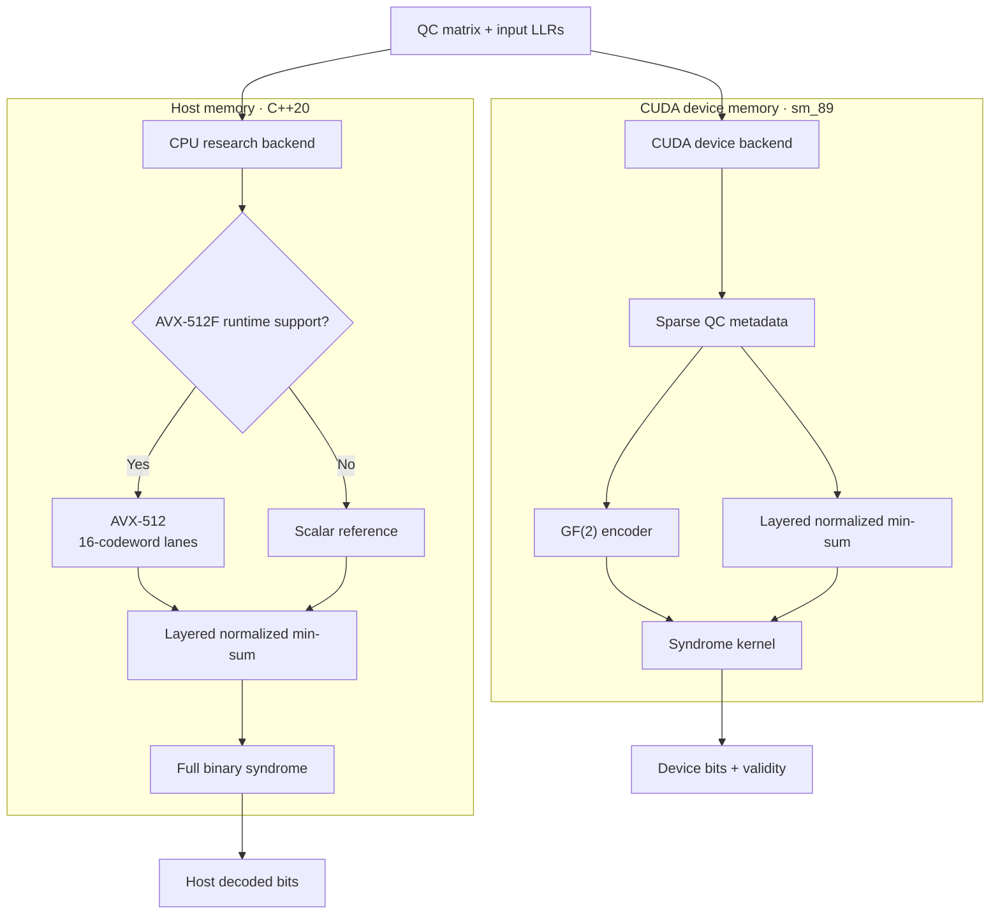
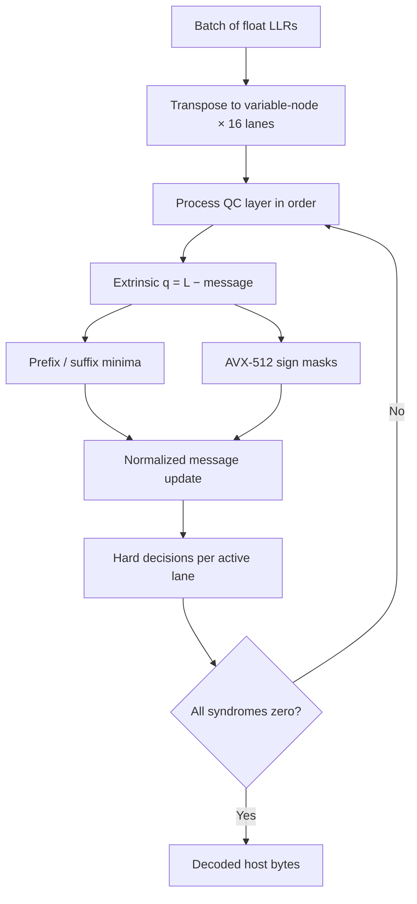
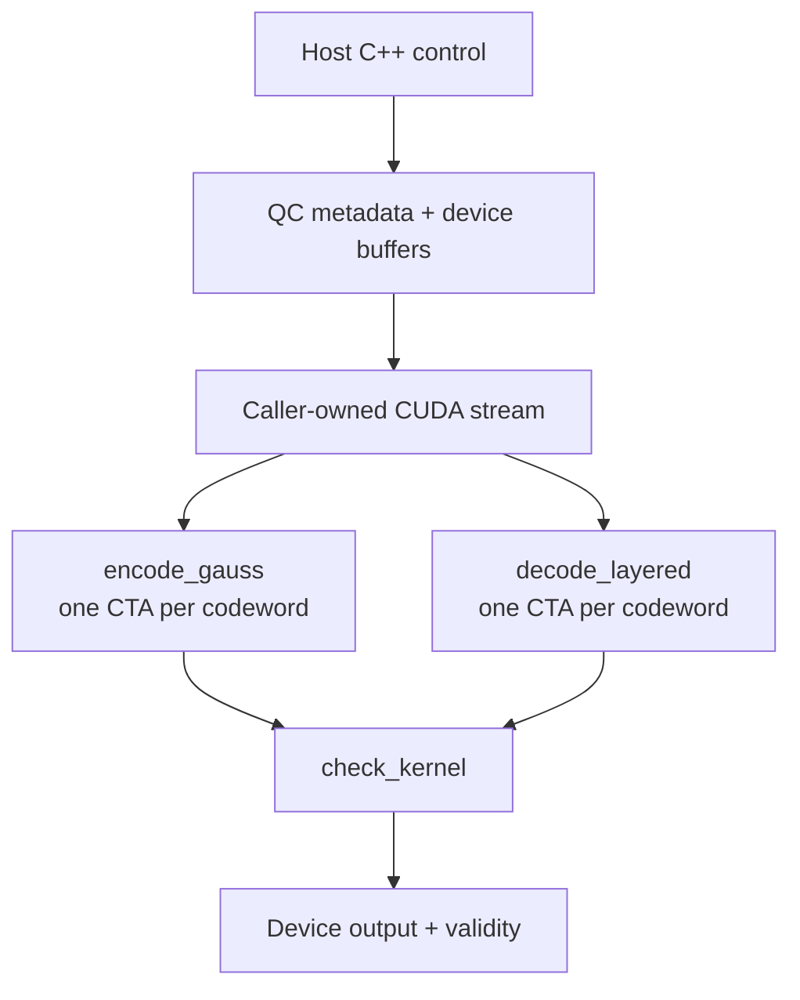
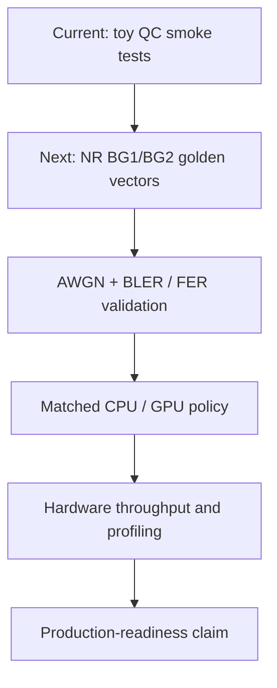

# Two-backend LDPC research proof of concept

This source archive is based on the existing `GPU_LDPC_CPP_CUDA_Source` project. It contains a **separate CPU research decoder**, not a CUDA CPU fallback. The CUDA path remains device-only for LDPC coding and decoding.

## Backend topology



The two paths share the matrix convention and LLR sign convention, but they do not share execution state or silently dispatch between host and device.

## Branch strategy

- `feature/x86-avx512-decoder`: add `src/cpu_decoder.cpp`, `include/nrldpc/cpu_decoder.hpp`, `tests/test_cpu.cpp`, `benchmarks/benchmark_cpu.cpp`, and the CMake build switch. On x86-64 GCC/Clang with AVX-512F, it decodes 16 independent codewords concurrently using AVX-512, with layered normalized min-sum and prefix/suffix minimum reuse. Scalar reference is for correctness and non-AVX build sanity checking, **not** a fallback used by GPU decoding.
- `feature/cuda-rtx4090-decoder`: retain existing CUDA LDPC encode/decode/check, and merge the existing `feature/algorithm5-fb-decoder` branch. Build with CUDA `sm_89`; do not claim performance until actual GPU validation.

## x86 / local development build (CUDA not required)

```bash
cmake -S . -B build-cpu -DNRLDPC_ENABLE_CPU=ON -DNRLDPC_ENABLE_CUDA=OFF -DCMAKE_BUILD_TYPE=Release
cmake --build build-cpu -j
ctest --test-dir build-cpu --output-on-failure
./build-cpu/ldpc_cpu_bench matrices/toy_qc_z4.txt 256 10
```

A MacBook Air using Apple Silicon builds the **scalar test only**. Genuine AVX-512 requires supported x86-64 hardware and OS support; the benchmark prints which backend ran.

## NVIDIA RTX 4090 CUDA build (on Linux CUDA toolkit)

```bash
cmake -S . -B build-cuda -DNRLDPC_ENABLE_CPU=OFF -DNRLDPC_ENABLE_CUDA=ON -DCMAKE_CUDA_ARCHITECTURES=89 -DCMAKE_BUILD_TYPE=Release
cmake --build build-cuda -j
ctest --test-dir build-cuda --output-on-failure
./build-cuda/ldpc_bench matrices/toy_qc_z4.txt 32 10
```

## Limitations and correctness

- The bundled QC matrix is a **toy test matrix**; no NR BG1/BG2 conformance is claimed.
- The CPU decoder is a first proof-of-concept implementation using float LLRs; it is not quantized INT8, OpenMP-threaded, or tuned for high-throughput BG1/BG2.
- The current CUDA encoder remains a very slow generic GF(2) solver; no complete 5G NR transport/rate matching/HARQ pipeline exists.
- CPU tests were built and executed on a Linux x86-64 machine with AVX-512F support. CUDA compilation and hardware tests remain outstanding.
- Throughput from `benchmark_cpu.cpp` includes only decoder execution, warm-up plus five timed repeats. Its noiseless all-zero input permits early termination, so it must not be compared to published FER=1e-5 results.
- To assess BLER, add independent golden vectors, AWGN, 3GPP NR BG1/BG2 tables and an identical stopping/quantization policy.

## Technical detail

Both implementations operate on non-packed bits and LLR = log(P(bit=0) / P(bit=1)). The CPU decoder uses a sparse edge list derived from the QC exponent matrix, preserves layer order, and checks the full binary syndrome before stopping. The AVX-512F path vectorizes across 16 codewords; sign parity is accumulated with AVX-512 compare masks and the edge-excluding minimum comes from prefix/suffix arrays.

### CPU decoder flow



The scalar implementation follows the same layered update and stopping rule one codeword at a time. It is a correctness reference and portability path, not evidence of AVX-512 throughput.

### CUDA codec flow



Allocation and kernel launches are asynchronous where supported. Device pointer lifetime and stream synchronization remain the caller's responsibility.

### Validation path



Only the first stage is represented by the bundled matrix and repository tests. Performance and 5G NR compliance claims require every later stage under controlled, reproducible conditions.
